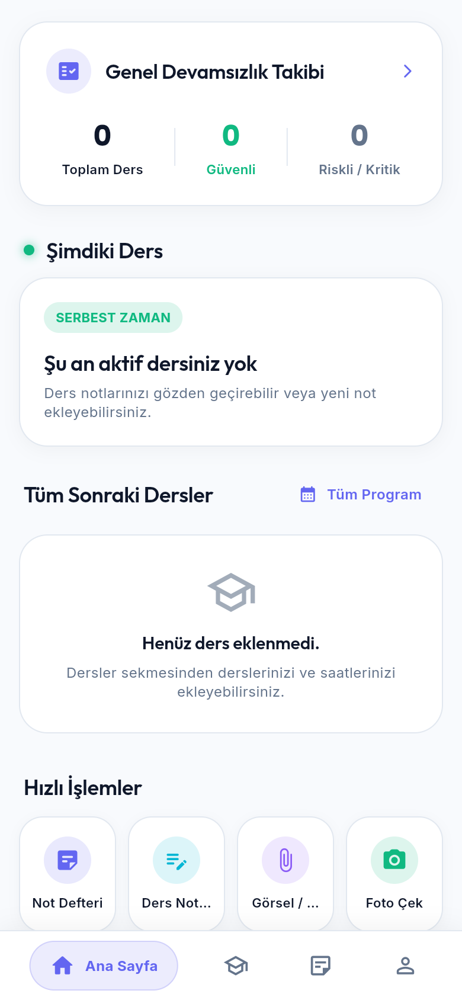
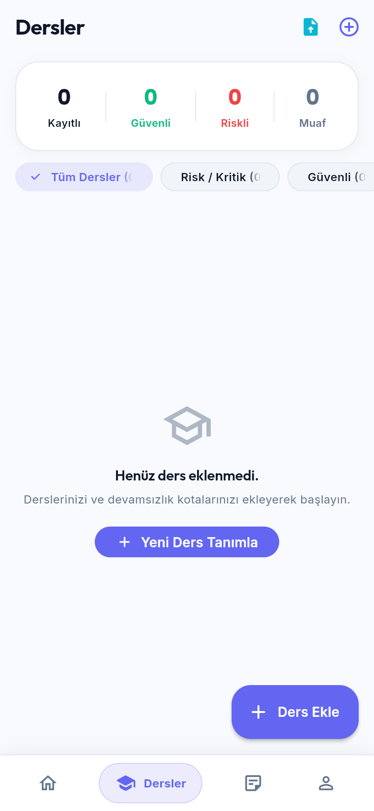
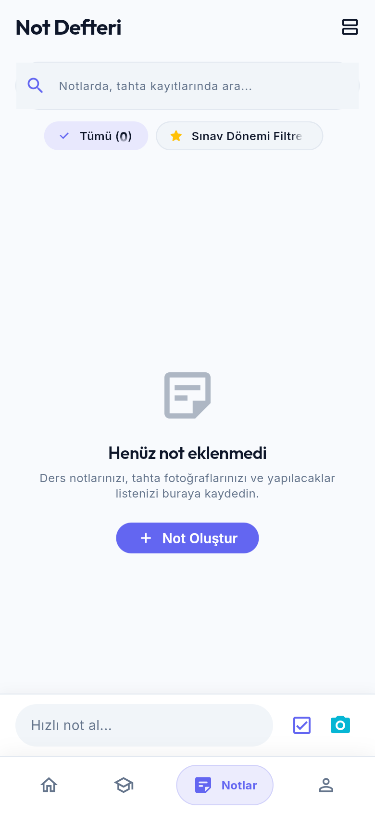

<p align="center"><a href="https://oidioom.com"><picture><source media="(prefers-color-scheme: dark)" srcset=".github/assets/oidioom-dark.svg"></picture></a></p>

<h1 align="center">🎓 Kampüs Asistanı</h1>

<p align="center"><b>Your smart campus companion — schedule, attendance and notes in one place.</b></p>

<p align="center">
  
  
  
  
  
  
  <a href="https://oidioom.com"></a>
</p>

<p align="center"><a href="#-english">🇬🇧 English</a> · <a href="#-türkçe">🇹🇷 Türkçe</a></p>

---

## 🇬🇧 English

Kampüs Asistanı helps university students stay on top of their semester. Import your timetable with OCR, track attendance per course with risk levels, keep digital notes and get suggestions for the free gaps between classes.

> [!NOTE]
> This is a **showcase repository**. Kampüs Asistanı is closed-source; this repo contains the project overview, screenshots and a few short code excerpts.

## ✨ Features

- 📸 OCR onboarding: import your timetable from a photo or file
- 📊 Attendance tracking with automatic risk levels (safe / warning / critical)
- 📝 Digital notes and course notes with attachments
- ⏱️ Live 'current class' card and upcoming classes
- 💡 Smart suggestions for gaps between classes
- 📅 Calendar export and in-app notifications

## 📸 Screenshots

<table>
<tr><td align="center"><br><sub>Dashboard</sub></td><td align="center"><br><sub>Courses</sub></td><td align="center"><br><sub>Notes</sub></td></tr>
</table>

## 🧩 Code Showcase

A few real, short excerpts from the codebase — each with a note on what it does and where it is used. See the [`showcase/`](showcase) folder.

**[`attendance_risk.dart`](showcase/attendance_risk.dart)** — Decides how risky a course's attendance is, based on the remaining allowed absent hours. _Drives the colored risk badges on the dashboard and course list._

```dart
RiskLevel getRiskLevel(int currentAbsentHours) {
  if (!trackAttendance) return RiskLevel.exempt;
  final allowed = maxAllowedAbsentHours;
  if (currentAbsentHours > allowed) return RiskLevel.failed;
  final remaining = allowed - currentAbsentHours;
  if (remaining <= 2) return RiskLevel.high;
  if (remaining <= 4) return RiskLevel.medium;
  return RiskLevel.low;
}
```

**[`max_absence.dart`](showcase/max_absence.dart)** — Computes the maximum absent hours from the semester length and minimum attendance rule. _Used when a course is created or its schedule changes._

```dart
int get maxAllowedAbsentHours {
  if (customMaxAbsentHours != null) return customMaxAbsentHours!;
  if (totalSemesterHours == 0) return 0;
  final maxRatio = (100.0 - minAttendancePercentage) / 100.0;
  return (totalSemesterHours * maxRatio).floor();
}
```

## 🛠️ Built With

Flutter · Dart · Provider · shared_preferences · image_picker · file_picker

## 📄 License

© 2026 Oidioom / Tarek Sharabaty. All rights reserved. See [LICENSE](LICENSE).

---

## 🇹🇷 Türkçe

**Akıllı kampüs asistanınız — ders programı, devamsızlık ve notlar tek yerde.**

Kampüs Asistanı, üniversite öğrencilerinin dönemi kontrol altında tutmasına yardım eder. Ders programını OCR ile içe aktarın, her ders için devamsızlığı risk seviyeleriyle takip edin, dijital notlar tutun ve dersler arasındaki boşluklar için öneriler alın.

> [!NOTE]
> Bu bir **vitrin (showcase) deposudur**. Kampüs Asistanı kapalı kaynaklıdır; bu depoda proje tanıtımı, ekran görüntüleri ve birkaç kısa kod alıntısı bulunur.

## ✨ Özellikler

- 📸 OCR ile kurulum: ders programını fotoğraftan veya dosyadan içe aktarın
- 📊 Otomatik risk seviyeli devamsızlık takibi (güvenli / dikkat / kritik)
- 📝 Ekli dijital notlar ve ders notları
- ⏱️ Canlı 'şimdiki ders' kartı ve sıradaki dersler
- 💡 Dersler arası boşluklar için akıllı öneriler
- 📅 Takvime aktarma ve uygulama içi bildirimler

## 🧩 Kod Vitrini

Kod tabanından kısa ve gerçek alıntılar; kodlar yukarıdaki İngilizce bölümde gösterilmiştir. Hepsi [`showcase/`](showcase) klasöründe:

- **[`attendance_risk.dart`](showcase/attendance_risk.dart)** — Kalan devamsızlık hakkına göre bir dersin risk seviyesini belirler. _Ana sayfadaki ve ders listesindeki renkli risk rozetlerini belirler._

- **[`max_absence.dart`](showcase/max_absence.dart)** — Dönem uzunluğu ve asgari devam şartından maksimum devamsızlık saatini hesaplar. _Ders eklendiğinde veya programı değiştiğinde kullanılır._

## 🛠️ Kullanılan Teknolojiler

Flutter · Dart · Provider · shared_preferences · image_picker · file_picker

## 📄 Lisans

© 2026 Oidioom / Tarek Sharabaty. Tüm hakları saklıdır. Ayrıntılar için [LICENSE](LICENSE).

---

<p align="center"><a href="https://oidioom.com"><picture><source media="(prefers-color-scheme: dark)" srcset=".github/assets/oidioom-dark.svg"></picture></a></p>
<p align="center"><b>by Oidioom — Tarek Sharabaty</b><br>
<a href="https://oidioom.com">oidioom.com</a> · <a href="https://github.com/tariksharabaty">GitHub</a> · <a href="https://modrinth.com/organization/oidioomstudio">Modrinth</a> · <a href="https://gear.oidioom.com">Gear</a> · <a href="https://www.instagram.com/oidioom">Instagram</a></p>
